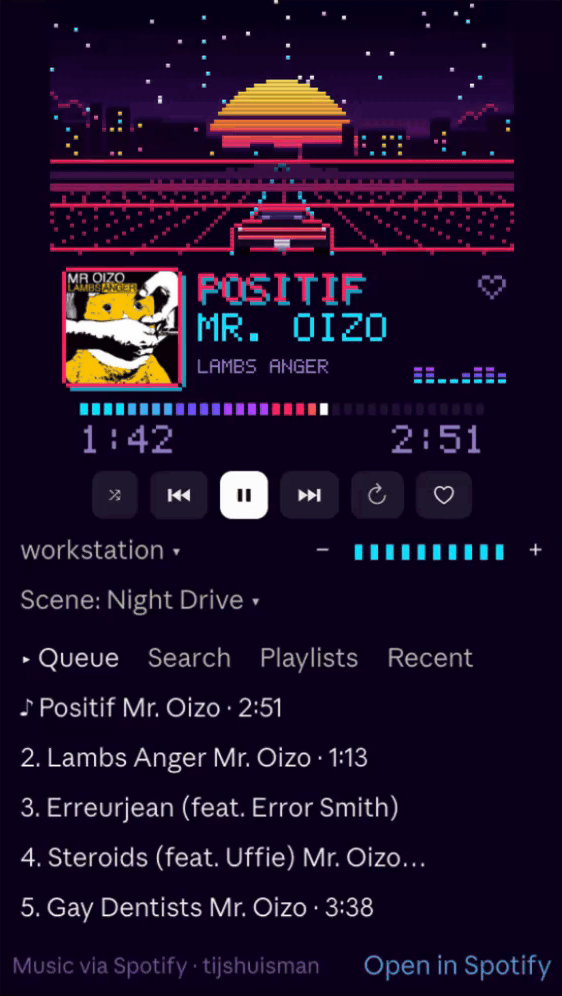

# Pixel Tunes

A [Claude Code mod](https://code.claude.com/docs/en/plugins/mods/overview) that puts a pixel-art Spotify player in a pane next to your chat. The scene on top changes with the music.

<p align="center"></p>

## Scenes

Pixel Tunes has six scenes, one for each kind of music. A scene only moves while music plays.

<table>
  <tr>
    <td width="186"></td>
    <td><b>Night Drive</b>, the default<br>synthwave, retrowave, outrun, vaporwave, darksynth, dreamwave</td>
  </tr>
  <tr>
    <td width="186"></td>
    <td><b>Campfire</b><br>folk, indie folk, folk rock, folk pop, chamber folk, contemporary folk, alt-country, americana, country, bluegrass, singer-songwriter, folktronica, stomp and holler, acoustic</td>
  </tr>
  <tr>
    <td width="186"></td>
    <td><b>City Lights</b><br>rock of any kind (indie rock, garage rock, art rock…), punk and post-punk, new wave, indie, alternative, britpop, grunge, art pop, baroque pop, chamber pop</td>
  </tr>
  <tr>
    <td width="186"></td>
    <td><b>Dance Floor</b><br>house (French house, deep house…), disco and nu disco, dance, dance-punk, big beat, UK garage, techno, electroclash</td>
  </tr>
  <tr>
    <td width="186"></td>
    <td><b>Psychedelic</b><br>psychedelic rock, pop and folk, neo-psychedelia, freak folk, surf, space rock, acid rock, krautrock</td>
  </tr>
  <tr>
    <td width="186"></td>
    <td><b>Dream Pop</b><br>dream pop, shoegaze, slowcore, downtempo, ambient, ambient pop, chillwave, ethereal wave, trip hop</td>
  </tr>
</table>

Pixel Tunes picks the scene in this order:

1. **Your own pick.** Choose a scene with the *Scene* button in the pane. It stays until you choose *Automatic* again.
2. **A playlist you remembered.** After picking a scene, choose *Remember for this playlist*.
3. **An artist you remembered.** *Remember for this artist* does the same for an artist, also when they are a guest on a track.
4. **Words in the playlist's name.** *Indie Folk Evenings* gets Campfire, *Late Night Synthwave* gets Night Drive, *Lo-fi for coding* gets Dream Pop.
5. **The artist's genres on MusicBrainz**, if you turn on `genre_lookup`.
6. **Otherwise:** Night Drive.

## What it does

- Shows what is playing: album art, title, artist, progress and an animated scene.
- Controls Spotify: play and pause, previous and next, shuffle, repeat, like, volume, and a choice of device.
- Finds music without switching to the Spotify app: search for tracks, albums, playlists and artists, browse your playlists and recently played, and add to the queue.
- Lets Claude be your DJ: ask it to put something on, like "play Nightcall by Kavinsky" or "put on something for a late-night coding session".
- Shows what plays in Claude's spinner: *Thinking · ♪ Nightcall – Kavinsky…*
- Has a demo mode, so you can look around before you connect Spotify.

Pixel Tunes doesn't play the sound itself. The music plays on a Spotify Connect device, such as the Spotify app on your Mac or phone, or a speaker.

## Requirements

- Claude Code with mods. The pixel-art pane shows in the desktop app's Code tab; in a terminal you get a short text version.
- macOS with the Xcode Command Line Tools.
- Spotify Premium.
- A Spotify app of your own, for its Client ID. See below.

## Spotify setup

1. Go to the [Spotify Developer Dashboard](https://developer.spotify.com/dashboard) and log in.
2. Click **Create app** and fill in any name and description.
3. As **Redirect URI**, add exactly `http://127.0.0.1:8898/callback`.
4. Under the APIs used, tick **Web API**. Accept the terms and save.
5. Open the app's settings and copy its **Client ID**. You don't need the client secret.

To let someone else use your app, add them under **User Management**. An app works for at most five Spotify users.

## Install

At the prompt of a terminal session:

```
/plugin install pixel-tunes --marketplace tijshuisman/claude-pixel-tunes
```

Answer `y` to add the marketplace, choose a scope, and fill in your Client ID when asked.

From a shell, with your Client ID in place of `YOUR_CLIENT_ID`:

```
claude plugin install pixel-tunes --marketplace tijshuisman/claude-pixel-tunes --config spotify_client_id=YOUR_CLIENT_ID
```

In the desktop app: click **+** next to the prompt box, then **Plugins**, **Add marketplace** with `tijshuisman/claude-pixel-tunes`, then **Add plugin**.

Then run `/tunes` to open the pane and click **Connect Spotify**. Your browser opens Spotify's login; after you agree, the pane connects. If it doesn't, paste the address from your browser's address bar into the pane.

## Update

By default, Pixel Tunes doesn't update by itself. To update, run this in a shell:

```
claude plugin update pixel-tunes@claude-pixel-tunes
```

Or, at the prompt of a terminal session, run `/plugin`, open Pixel Tunes on the **Installed** tab and select **Update now**.

To update automatically, turn on auto-update once, in a terminal session: run `/plugin`, go to the **Marketplaces** tab, pick `claude-pixel-tunes` and select **Enable auto-update**.

The new version loads in your next session, in the terminal and in the desktop app.

## Use

| Command | |
|---|---|
| `/tunes` | Open the pane |
| `/tunes play`, `/tunes pause` | Play or pause |
| `/tunes next`, `/tunes prev` | Next or previous track |
| `/tunes login`, `/tunes logout` | Log in to Spotify, or log out |
| `/tunes debug` | Troubleshoot the album art and the genre lookup |

In the desktop app, you can also open the pane with the **♪ Pixel Tunes** button above the prompt.

## Options

You set them when you install. To change them later, run `/config` in a terminal session.

| Option | Default | |
|---|---|---|
| `spotify_client_id` | none | The Client ID of your Spotify app |
| `callback_port` | `8898` | The port in your redirect URI. Change both together. |
| `genre_lookup` | off | Look up the playing artist's genres on MusicBrainz to pick the scene |

## Privacy

- Your Spotify login stays on your Mac, in the Keychain. `/tunes logout` removes it.
- Your remembered scenes stay on your Mac too.
- Claude never sees titles, artists or album art. When it plays something for you, it only hears whether playback started.
- With `genre_lookup` on, Pixel Tunes sends the playing artist's Spotify ID to [musicbrainz.org](https://musicbrainz.org), or the track's ISRC code if MusicBrainz doesn't know that ID. Otherwise it only talks to Spotify.

## Development

```
claude plugin validate pixel-tunes
claude plugin test pixel-tunes
```

The tests run against a fake Spotify and MusicBrainz. To load your working copy in every session, point `CLAUDE_CODE_PLUGIN_DIRS` at the `pixel-tunes` folder (in the `env` of `~/.claude/settings.json`).

## License

[MIT](LICENSE). Pixel Tunes is not affiliated with or endorsed by Spotify. Spotify is a trademark of Spotify AB.
